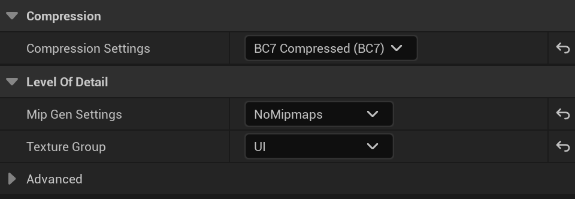
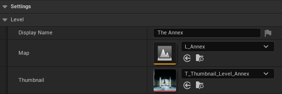

# Add a level to the lobby

After this guide, your map has its own card, with a name and a picture, in the lobby and on the **SOLO RUN** page. The host clicks the card, then **START THE RUN**, and the crew plays your map. Alone, a player does the same from **SOLO RUN**.

A card is a level Data Asset in the `Levels` list of `BP_FriendslopGameInstance`. The lobby and the **SOLO RUN** page both read that list. Adding a level opens no graph.

## Before you start

- MPFriendslopV2 open in Unreal Engine 5.8.

---

## Make the map

`L_Annex` is a complete run map with no generator. A copy of it already has the players, the loot, the extraction, the lamps and the look.

1. In the **Content Browser**, open `Content/MPFriendslop/Maps/L_Annex`.
2. Open **File**, then **Save Current Level As**.
3. Save the copy in `Maps/`, as `L_` followed by your map's name, for example `L_Warehouse`.
4. Change the rooms. Keep the `PlayerStart` actors, the extraction trap and some loot spawn points.
5. Save.

What a run map needs, actor by actor, is on [Build your own level](../world/build_your_own_level.md).

---

## Make the picture

The card shows a 16:9 picture at 256 x 144. The shipped pictures are 512 x 288, so they stay sharp on a large screen.

1. In your map, move the view to the shot you want on the card.
2. Press **G** to hide the editor icons.
3. In the **Cmd** box at the bottom of the editor, type `HighResShot 1920x1080`, then press **Enter**.
4. Unreal writes the picture to `Saved/Screenshots/WindowsEditor/` in the project folder.

Any 16:9 picture of your own works too.

---

## Import the picture

1. In the **Content Browser**, open `Content/MPFriendslop/Textures/Widgets/Levels/`.
2. Drag the picture file into the folder.
3. Rename the new texture `T_Thumbnail_Level_` followed by your map's name.
4. Open the texture.
5. Set `Compression Settings` to `BC7`.
6. Set `Mip Gen Settings` to `NoMipmaps`.
7. Set `Texture Group` to `UI`.

    { width="480" }

8. Save.

---

## Make the level Data Asset

1. Open `Content/MPFriendslop/Blueprints/DataAssets/Level/Childs/`.
2. Right click in the folder, then click **Miscellaneous**, then **Data Asset**.
3. Pick `BP_LevelDataAsset`, then click **Select**.
4. Name it `DA_Level_` followed by your map's name.
5. Open it.
6. In `Display Name`, type the name the card shows.
7. In `Map`, pick your map.
8. In `Thumbnail`, pick your texture.

    { width="580" }

9. Save.

---

## Add the card to the lobby

1. Open `Content/MPFriendslop/Blueprints/Misc/BP_FriendslopGameInstance`.
2. Click **Class Defaults** in the toolbar.
3. In the **Details** panel, find `Levels`, under `Settings` then `Level`.
4. Click the **+** next to `Levels`. A new row appears at the end of the list.
5. In the new row, pick your `DA_Level_` Data Asset.
6. Click **Compile**, then **Save**.

The cards follow the order of the list. The first card is the one picked when a page opens.

The **SOLO RUN** page shows the same cards, so your level is there too.

---

## Change the picture of a card

1. Import the new picture as in [Import the picture](#import-the-picture).
2. Open the level Data Asset of the card, for example `DA_Level_Annex` for **THE ANNEX**.
3. In `Thumbnail`, pick the new texture.
4. Save.

The name under the picture is `Display Name`, in the same Data Asset.

---

## Check that it works

1. Open `Content/MPFriendslop/Maps/L_MainMenu`.
2. Click **Play**, then **HOST RUN**.
3. Click the **HOST** tab.
4. Look at the left of the page. Your card shows after the two shipped ones, with its picture.
5. Click your card. Its frame and its name turn amber.
6. Click **OPEN LOBBY**, then **START THE RUN**. The run starts on your map.

## If it does not work

| What you see | What to check |
|---|---|
| The card shows an empty white frame | `Thumbnail` is empty in the level Data Asset. Pick the texture, then save |

---

[Join the Discord](https://discord.gg/EqHCtq38jy)
